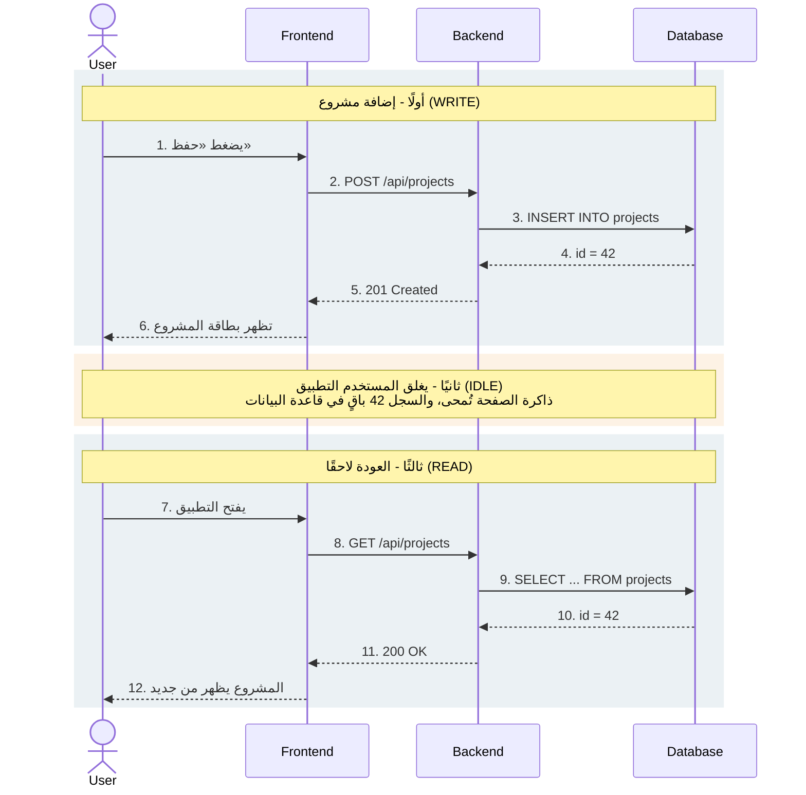

# ماذا يحدث عندما يحتاج التطبيق إلى تذكّر البيانات؟

**إعداد: هبة إسماعيل و دينا المغربي**

*Frontend · Backend · Database*

---

الشاشة تعرض البيانات لكنها لا تحفظها. الحفظ الدائم يحدث في قاعدة بيانات، ولا تصل إليها الواجهة مباشرة. يمر الطلب عبر خادم يتحقق منه ثم يكتبه. يتبع هذا الملف مشروعًا واحدًا في ملف مهني، من لحظة إدخاله حتى عودة صاحبه في اليوم التالي.

---

## السؤال البحثي الأول: ما الفرق بين الواجهة الأمامية والخادم وقاعدة البيانات؟

ثلاثة أجزاء، ولكل جزء عمل واحد واضح.

### الواجهة الأمامية (Frontend)

- **ما هي:** الجزء الذي يراه المستخدم ويلمسه: الصفحات والنماذج والأزرار. تعمل داخل المتصفح أو تطبيق الهاتف. تجمع ما يكتبه المستخدم، وتتحقق منه تحققًا أوليًا، وتعرض النتائج.
- **في الملف المهني:** نموذج «إضافة مشروع» وبطاقات المشاريع.
- **هل تتذكر؟** ذاكرة مؤقتة. ما في الصفحة من متغيرات يزول عند التحديث أو الإغلاق.

### الخادم (Backend)

- **ما هو:** برنامج يعمل على جهاز بعيد ويقف بين الواجهة وقاعدة البيانات. يتأكد من هوية المستخدم وصلاحياته، ويطبّق قواعد التطبيق، ويحوّل الطلبات إلى أوامر تفهمها قاعدة البيانات.
- **في الملف المهني:** يستقبل طلب إضافة مشروع، ويرفضه إذا خلا من العنوان، ثم يحفظه باسم صاحب الحساب.
- **هل يتذكر؟** يعالج ولا يخزّن. كل طلب مستقل، وما يوضع في ذاكرة الخادم يضيع عند إعادة تشغيله.

### قاعدة البيانات (Database)

- **ما هي:** نظام مخصص لتخزين البيانات على وسائط دائمة وتنظيمها واسترجاعها بالاستعلام. تبقى البيانات فيه بعد إغلاق التطبيق وإعادة تشغيل الخادم، وتؤخذ منه نسخ احتياطية.
- **في الملف المهني:** جدول `projects`، وكل مشروع صف فيه: المعرّف وصاحب الملف والعنوان والوصف والرابط.
- **هل تتذكر؟** ذاكرة دائمة. هي الجزء الوحيد الذي صُمم ليحتفظ بالبيانات.

---

## الناتج: مخطط معمارية التطبيق

### رحلة مشروع واحد

مستخدم يضيف مشروعًا إلى ملفه المهني، ثم يغلق التطبيق ويعود لاحقًا.



نسخة نصية للمخطط:

```
User ──▶ Frontend ──▶ Backend ──▶ Database
  1. يضغط «حفظ»
        2. POST /api/projects
                  3. INSERT INTO projects
                  ◀── 4. id = 42
        ◀── 5. 201 Created
  ◀── 6. تظهر بطاقة المشروع

  [يغلق التطبيق: ذاكرة Frontend تُمحى، السجل 42 يبقى في Database]

  7. يفتح التطبيق
        8. GET /api/projects
                  9. SELECT ... FROM projects
                  ◀── 10. id = 42
        ◀── 11. 200 OK
  ◀── 12. المشروع يظهر من جديد
```

### أين توجد البيانات في كل لحظة؟

| اللحظة | الواجهة | الخادم | قاعدة البيانات |
|---|---|---|---|
| يكتب البيانات في النموذج | النص في ذاكرة الصفحة فقط | لا يعلم بشيء | لا شيء |
| بعد الرد (الخطوتان 5 و6) | بطاقة المشروع معروضة | أنهى الطلب ولا يحتفظ بالمشروع | السجل `id=42` محفوظ على القرص |
| بعد إغلاق التطبيق | لا شيء، فالذاكرة زالت | ينتظر طلبًا جديدًا | السجل `id=42` ما زال موجودًا |
| بعد العودة (الخطوة 12) | قائمة أُعيد بناؤها من رد الخادم | قرأ السجل وأرسله | السجل `id=42` ما زال موجودًا |

لاحظ أن الواجهة تعرض المشروع في الصف الثاني والرابع، لكنها لا تملكه. ما تعرضه نسخة استلمتها للتو من الخادم.

---

## السؤال البحثي الثاني: لماذا لا يعني ظهور البيانات على الشاشة أنها محفوظة؟

ما تعرضه الشاشة صورة لحالة التطبيق في تلك اللحظة، وتكون محفوظة غالبًا في ذاكرة الصفحة. هذه الذاكرة تُمسح بمجرد تحديث الصفحة أو إغلاقها. والبيانات المعروضة قد تأتي من مصادر مختلفة، وبعضها لا يحفظ شيئًا.

| مصدر ما تراه | يبقى بعد تحديث الصفحة؟ | يظهر على جهاز آخر؟ |
|---|---|---|
| أمثلة مكتوبة داخل الكود | تظهر دائمًا، لكنها ليست بيانات المستخدم | نعم، لأنها جزء من التطبيق نفسه |
| حالة في ذاكرة الصفحة | لا | لا |
| تخزين المتصفح | نعم | لا، في هذا المتصفح فقط |
| قاعدة بيانات عبر الخادم | نعم | نعم، مع الحساب نفسه |

### اختبار من ثلاث خطوات

1. أضف عنصرًا ثم حدّث الصفحة. إذا اختفى فهو في ذاكرة الصفحة فقط.
2. افتح التطبيق من متصفح آخر أو جهاز آخر بالحساب نفسه. إذا لم يظهر فهو مخزَّن في المتصفح الأول فقط.
3. أغلق المتصفح وعد في اليوم التالي. إذا ظهر العنصر بعد الاختبارين فهناك على الأرجح خادم وقاعدة بيانات تعمل.

---

## السؤال البحثي الثالث: ما الفرق بين التخزين المحلي في المتصفح وقاعدة البيانات؟

التخزين المحلي (`localStorage`) مساحة صغيرة داخل المتصفح يستطيع الموقع الكتابة فيها. هو حفظ حقيقي لكنه محدود بجهاز واحد ومتصفح واحد.

| | التخزين المحلي | قاعدة البيانات |
|---|---|---|
| أين تُحفظ البيانات؟ | داخل المتصفح على جهاز المستخدم | على خادم أو خدمة سحابية |
| من يصل إليها؟ | أي سكربت يعمل في الصفحة نفسها، والمستخدم نفسه | الخادم بعد التحقق من الهوية والصلاحيات |
| الانتقال بين الأجهزة | لا، لكل متصفح نسخته | نعم، مرتبطة بالحساب |
| عند مسح بيانات المتصفح | تضيع | تبقى |
| الحجم | نحو 5 ميغابايت لكل موقع في أغلب المتصفحات، ونصوص فقط | يتسع لملايين السجلات بأنواع مختلفة |
| البحث والعلاقات | لا يوجد، تقرأ المفتاح وتعالج القيمة بنفسك | استعلامات وعلاقات بين الجداول ومعاملات آمنة |
| متى يناسب؟ | تفضيلات الواجهة ومسودة لم تُرسل بعد | بيانات المستخدم التي يجب ألا تضيع |

---

## هدف البحث: علامات تدل على أن الحفظ غير حقيقي بعد

- تختفي البيانات بعد تحديث الصفحة.
- تظهر البيانات على جهاز واحد فقط.
- لا يوجد حساب يربط البيانات بصاحبها.
- الصفحة تعرض أمثلة ثابتة مكتوبة في الكود مهما أضاف المستخدم.
- زر «حفظ» يغيّر الشاشة دون أن يرسل طلبًا إلى أي خادم.

**التطبيق الذي يبدو مكتملًا يحتاج إلى ثلاثة أشياء كي يتذكر: واجهة ترسل، وخادم يتحقق، وقاعدة بيانات تكتب.**
